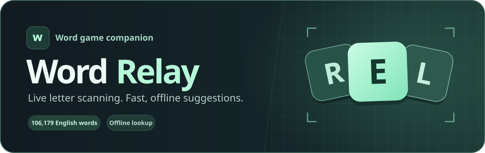
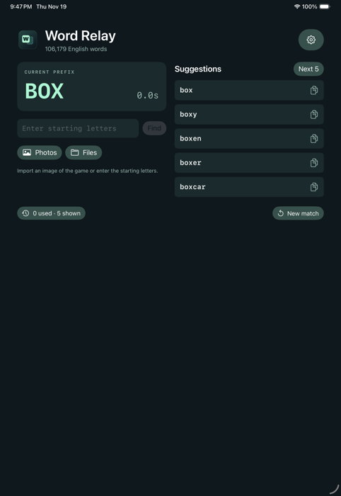

  

  <a href="#downloads"><strong>Download Word Relay</strong></a>
  · <a href="#start-a-match">Quick start</a>
  · <a href="#build-from-source">Build from source</a>
  · <a href="assets/word-relay-mark.svg">Logo</a>

# Word Relay

Word Relay reads letter tiles and finds English words that start with the full prefix. The bundled dictionary has **106,179 words** and works offline. Choose **1–100 suggestions per batch** and save **up to 100 custom words**.

## Downloads

| Platform | Download | How it works |
| --- | --- | --- |
| **macOS** | [Universal ZIP for macOS 14+](https://github.com/Fatennalover/word-relay/releases/download/v1.3.1/Word-Relay-for-macOS-1.3.1.zip) | Live Roblox window scanning, typed submission tracking, and screenshot lookup |
| **Windows** | [x64 ZIP](https://github.com/Fatennalover/word-relay/releases/download/v1.3.0/Word-Relay-for-Windows-x64-1.3.0.zip) · [ARM64 ZIP](https://github.com/Fatennalover/word-relay/releases/download/v1.3.0/Word-Relay-for-Windows-arm64-1.3.0.zip) | Live scanning of the visible Roblox window, typed submission tracking, and screenshot lookup |
| **Android** | [APK for Android 9+](https://github.com/Fatennalover/word-relay/releases/download/v1.3.0/Word-Relay-for-Android-1.3.0.apk) (ARM64 and x64) | Android screen sharing, floating suggestions, and screenshot lookup. Mark words played in the app. |
| **iPad** | [Simulator ZIP](https://github.com/Fatennalover/word-relay/releases/download/v1.3.0/Word-Relay-iPad-Simulator-1.3.0.zip) · [Xcode project](ipad/WordRelayPad.xcodeproj) | Import screenshots from Photos or Files, or enter letters manually. Mark words played in the app. |

## Start a match

**macOS.** Extract the ZIP, move Word Relay to Applications, and open it alongside Roblox. On macOS 15.2 or later, click **Start** and choose the Roblox window in Apple's window picker. On macOS 14 through 15.1, enable Word Relay under **Privacy & Security → Screen & System Audio Recording**, then quit and reopen it. Enable **Input Monitoring** separately if you want Word Relay to track words you submit in Roblox.

**Windows.** Extract the ZIP for your PC and run `WordRelay.exe`. Keep Roblox visible in the foreground while scanning. The ZIP includes the .NET runtime.

On both desktop apps, use **Control–Shift–S** to start scanning, **Control–Shift–D** to stop, and **Control–Shift–N** for a new match.

**Android.** Install the APK and open Word Relay. Tap **Start scan**. Enable **Display over other apps** for floating suggestions, then select Roblox in Android’s sharing dialog. On versions that offer sharing one app, select Roblox to limit the capture to its window. Tap the overlay’s close button, the in-app **Stop scan** button, or the Android sharing notification to stop. You can long-press a suggestion to mark it played.

**iPad.** Open the Xcode project and run it on an iPad simulator. Choose **Photos** or **Files** to read the letter tiles from an image, or type the prefix. Long-press a suggestion to mark it played. This edition uses image imports and manual lookup.

iPad simulator preview

## Suggestions and match history

Tap a word to copy it. **Next** cycles through batches of available suggestions. A word remains eligible until you submit it with desktop tracking enabled or mark it as played. Use **Undo** in match history if a word was rejected. Desktop and Android live scans keep the current suggestions visible through brief tile dropouts while the game clock is visible. Live match detection clears history when the game ends, and **New match** resets it manually.

## Build from source

| Platform | Build |
| --- | --- |
| **macOS** | Run `bash build.sh` with Xcode command-line tools. |
| **Windows** | Run `dotnet publish windows/WordRelay.Windows.csproj -c Release -r win-x64 --self-contained true -p:PublishSingleFile=true -p:IncludeNativeLibrariesForSelfExtract=true` with .NET 10. Use `win-arm64` for ARM64. |
| **Android** | Install the .NET 10 Android workload, Android SDK 36, and JDK 17 or later. Run `dotnet build android/WordRelay.Android.csproj -c Release`. |
| **iPad** | Open `ipad/WordRelayPad.xcodeproj` in Xcode, select an iPad simulator, and run the **WordRelayPad** scheme. For a physical iPad build, select your development team in **Signing & Capabilities**. |

The dictionary is based on the [English Speller Database](https://github.com/en-wl/wordlist), release 2026.02.25. The license notices for the [dictionary](Resources/ESDB-Copyright.txt) and [Fredoka](Resources/Fredoka-OFL.txt) are included in the source.

Word Relay is an independent companion app. Screen and image recognition run on the device.
